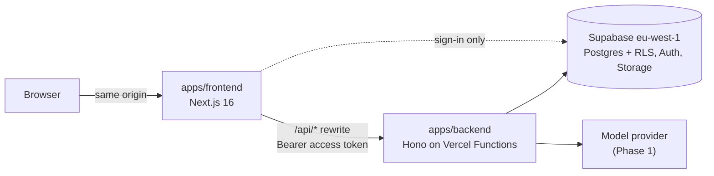

# AI Planning & Shopping Assistant

Users describe what they want to buy or build, in text or with an image. The assistant asks only the questions that matter and turns the answers into a live, structured plan: components, budget, new-or-used preferences and suitable products. Every later message updates the same plan through validated changes that the user can see and undo.

**Status:** Phase 0 (foundation) in progress. See [`docs/adr/`](docs/adr/) for the decisions so far.

## Architecture



- **`apps/frontend`** renders the conversation and the plan. It never touches the database or model providers.
- **`apps/backend`** verifies access tokens, runs the plan engine, calls the model and reads and writes data under row-level security.
- **`packages/contracts`** holds the Zod schemas for every API request and response; **`packages/domain`** holds the pure plan logic. Both apps use them.

Why the split and which alternatives were considered: [ADR-0001](docs/adr/0001-monorepo-and-stack.md). Accounts and model billing: [ADR-0002](docs/adr/0002-auth-and-model-billing.md).

## Getting started

Prerequisites: Node.js 24 (22.12+ works; `nvm use` reads `.nvmrc`) and pnpm (any recent version; it switches to the version pinned in `package.json` automatically). For a local database: Docker and the [Supabase CLI](https://supabase.com/docs/guides/local-development/cli/getting-started).

```bash
pnpm install
cp apps/backend/.env.example apps/backend/.env
cp apps/frontend/.env.example apps/frontend/.env.local
pnpm dev
```

Open http://localhost:3000. The page shows whether the backend answers through the `/api` rewrite; the backend itself runs on http://localhost:8787 (`/health`, `/v1/me`).

`apps/backend/.env` needs a Supabase URL and publishable key: from `supabase start` for the local stack, or from the dev project's dashboard (Project Settings → API Keys).

## Scripts

| Command                                    | What it does                                                         |
| ------------------------------------------ | -------------------------------------------------------------------- |
| `pnpm dev`                                 | backend, frontend and packages in watch mode                         |
| `pnpm check`                               | format check, lint, typecheck and tests                              |
| `pnpm lint`, `pnpm typecheck`, `pnpm test` | one check across every workspace                                     |
| `pnpm build`                               | builds the packages, type-checks the backend and builds the frontend |
| `pnpm format`                              | formats the repository with Prettier                                 |
| `pnpm --filter @app/backend test`          | runs a script in one workspace                                       |

## Deployment (Vercel)

Two Vercel projects from this repository, both with functions in `dub1` (Dublin, next to Supabase in Ireland; set in each `vercel.json`):

| Project  | Root Directory  | Environment variables                                              |
| -------- | --------------- | ------------------------------------------------------------------ |
| backend  | `apps/backend`  | `SUPABASE_URL`, `SUPABASE_PUBLISHABLE_KEY`, `ALLOWED_ORIGINS`      |
| frontend | `apps/frontend` | `BACKEND_URL` (the backend deployment's URL, needed at build time) |

Each `vercel.json` builds the workspace packages before the app. Nothing is deployed yet; the first deployment verifies this setup.

## Ground rules

- Products come only from official APIs, permitted feeds, licensed providers or the user's own input. No scraping of Tori, Vinted, Facebook Marketplace or other restricted sources.
- Mock data is labelled DEMO, and estimated prices are never shown as verified.
- WCAG 2.2 AA, GDPR and EU data residency are requirements from the first screen.

## Working with Claude Code

`CLAUDE.md` and `.claude/` contain the project instructions, skills, review agents and permissions. Setup and daily use: [`docs/claude-setup.md`](docs/claude-setup.md).
